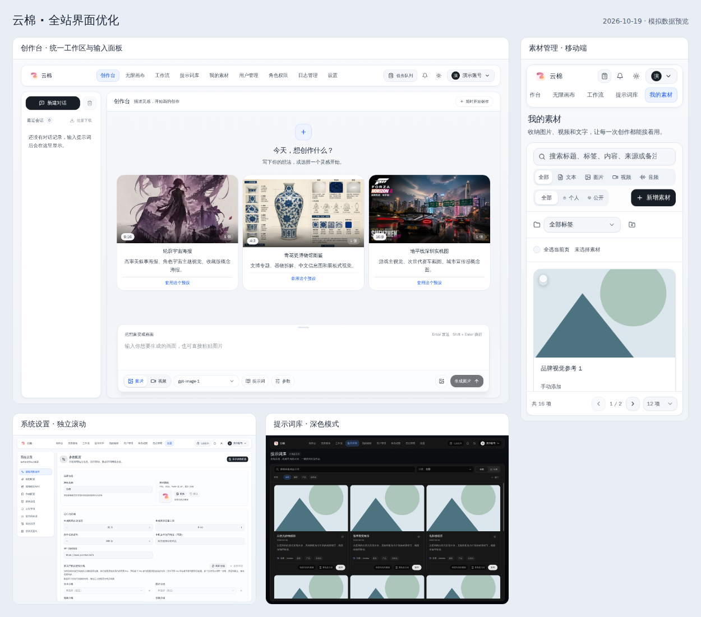
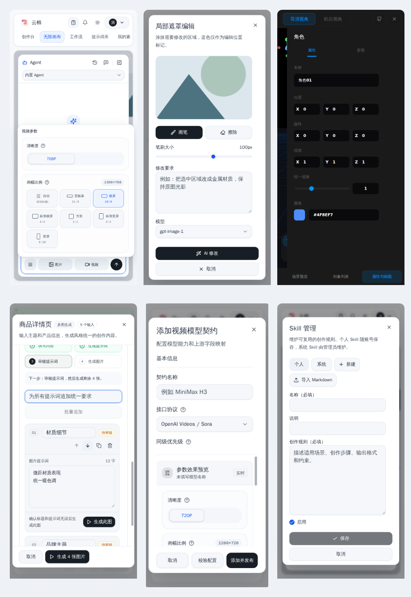

# 全站布局、样式与交互优化

本次覆盖全部 12 个业务页面，以及首页跳转、旧创作台入口和无效地址。系统设置的 9 个分区、个人中心的 4 个分区均逐项检查。

## 页面覆盖

| 页面 | 优化内容 |
| --- | --- |
| 登录 | 调整窄屏留白，避免主题按钮遮挡；补充表单内错误、必填校验、提交期间禁用与错误恢复。 |
| 创作台 | 统一侧栏、工作区和输入面板；搜索已加载的会话；显示输入区高度调节手柄；统一加载状态。 |
| 画布库 | 标题与数量层级、名称搜索、筛选结果全选、清除搜索、加载失败重试。 |
| 画布编辑器 | 工具栏按实际剩余画布宽度定位；节点抽屉、资源侧栏、图片工具、生成配置、摄像机、Agent、Skill、导演台与媒体工具均继续深入检查和优化。 |
| 工作流 | 页面标题和说明、可清除搜索、区分未创建与筛选无结果、提供创建或重置入口。 |
| 提示词库 | 页面标题与结果数量、搜索清除、分类列表限高滚动、标签展开滚动、无结果恢复。 |
| 我的素材 | 搜索独占窄屏首行，筛选按钮自适应，暴露选中状态；未选择时精简移动端批量操作；支持清除筛选和新增入口。 |
| 用户管理 | 用户信息优先于内部 ID；搜索支持中文输入法；加载与空状态位于列表内部；表格与分页统一。 |
| 角色权限 | 压缩移动端角色列表高度、突出当前角色、支持搜索清除、区分没有角色与没有搜索结果。 |
| 请求日志 | 搜索清除、今天／近 7 天／近 30 天、清除日期和确认选择；固定表头，紧凑分页。 |
| 系统设置 | 统一侧边分类导航与键盘导航；各分区内容独立滚动，标题和保存操作在手机与桌面持续可见。 |
| 个人中心 | 四个分区独立滚动；创作偏好和个人存储的保存操作保持可见；S3 / R2 与 WebDAV 支持键盘切换。 |
| 首页与异常页面 | 统一加载状态；验证失败提供重新加载；新增无效地址页面和路由错误边界，异常时保留主导航。 |

系统设置逐项覆盖：基础与数据库、模型配置、视频模型契约、存储配置、媒体治理、公告管理、提示词来源、日志治理、登录页图片。

个人中心逐项覆盖：账户概览、Key 选择、创作偏好、素材存储。

## 共享组件

- 统一页面间距、浅色表面、导航选中态、字体与按钮反馈，同时保留深色模式。
- 页面标题、说明和结果数量采用统一组件；空状态和加载状态统一呈现。
- 搜索支持清除按钮、Escape、中文输入法和焦点保留。
- 表格使用不透明固定表头；分页保留总数、页码和每页数量，并在窄屏收为单行。
- 小屏表单默认使用更易阅读的字号；短屏管理页保持足够的内容高度并允许页面滚动。
- 保留现有弹窗的固定头尾、焦点恢复与 Esc 关闭机制，并验证多种弹窗尺寸。

## 模块内部优化

这轮继续深入页面内部，包含无限画布和导演台，不只调整页面标题与外层容器。保留原有业务与持久化流程，根据实际宽度、滚动行为和操作状态修正问题。

| 模块 | 具体调整与验收 |
| --- | --- |
| 无限画布工作区 | 修正工具栏定位与紧凑断点，避免侧栏重复扣减可用宽度；资源侧栏统一搜索、筛选和选中态；手机节点抽屉与 Agent 增加关闭遮罩。 |
| 七类节点 | 检查文本、图片、视频、音频、全景、导演台与生成配置节点；核验参数、操作和详情的显示，生成配置分别切换图片、视频、音频和文本模式。 |
| 图片工具 | 裁剪、切图、放大、局部蒙版、多角度预览采用响应式高度与列宽；补齐模式选择语义，验证参数切换与固定操作区。 |
| 音频与预览 | 音频截取参数分组和摘要换行；使用合成 WAV 验证 0.5–2.5 秒选区与试听暂停；检查全景查看、大图缩放和重置。 |
| 摄像机与生成配置 | 标题、说明与开关分层；摄像机面板限高，展示启用摘要；配置说明完整换行，移除重复的关闭按钮；生成按钮统一进行中状态。 |
| 画布项目与素材 | 名称必填、200 字计数与示例提示；素材选择器固定头部、分组筛选、结果数量、空结果恢复与键盘焦点反馈。 |
| Agent 与 Skill | 起步建议仅填入并聚焦输入框；核验历史、运行设置、图片／视频参数及素材选择；Skill 提供空态、选中语义、必填提示，编辑保存区固定在底部。 |
| 3D 导演台 | 手机新增场景、对象列表、属性与截图三个入口；此前小屏隐藏的左右面板恢复可访问；工具栏换行、弹出菜单解除裁切，支持 Escape 回到场景。 |
| 工作流 | 五种变量类型使用明确的字段关联与必填语义，避免 boolean 嵌套标签；Agent 需求与草稿预览分层；素材选择支持清除搜索；核验批量草稿排序、统一追加、删除、应用到编辑器和任务结果。Agent 新草稿应用后正确显示“新建工作流”。 |
| 素材表单 | 中等屏幕即可显示左右预览；四类素材、可见范围采用明确分组，修正外层标签导致的按钮名称错误；必填信息、URL 名称、保存状态更清晰。 |
| 设置内部 | 图片模型能力分组、固定弹窗头尾；视频契约底部操作在小屏紧凑排列；提示词详情采用手机上下分区；存储选项卡支持方向键、Home、End。 |
| 公共模块 | 任务队列与公告固定标题、独立内容滚动；公告标题／时间／摘要分层并保持两行摘要；权限长名称和 API 路径换行，补充键盘焦点反馈。 |

## 验证

- `npm run lint`：通过，0 警告、0 错误。
- `npm test`：1001 项通过。
- `npm run build`：通过；Vite 仍提示部分分包大于 500 kB，没有修改分包警告阈值。
- `go test ./...`：通过。
- `git diff --check`：通过。
- 第一轮浏览器覆盖：33 项页面、65 项分区与交互、14 项短屏与恢复、7 项素材筛选宽度，共 119 条记录。
- 第二轮模块覆盖：60 条画布节点状态、13 条导演台状态、35 条画布工具与 Agent、48 条表单与设置、20 条工作流草稿与配置、8 条媒体与权限、6 条最终布局与主题，共 190 条记录。两轮合计 309 条页面、模块状态和交互记录。
- 第二轮还覆盖 1024×768、1280×720，以及导演台 320／390／768／1440 px 宽度；最终结果中没有未处理的页面错误或检查失败。
- 覆盖尺寸：1440×1000、1280×600、390×844、320×740、320×568；覆盖浅色与深色。
- 素材筛选栏额外复验宽度：320、360、390、640、768、1024、1440 px；搜索与筛选保持合理宽度，窄屏分行、宽屏单行，没有整页横向溢出。
- 常规页面检查未发现整页横向溢出或未处理的运行错误；可横向滚动的导航、筛选栏和宽表格保留独立滚动。
- 重点验证：搜索与清除、筛选结果全选、日期快捷选项、弹窗边界和关闭后焦点、设置固定标题、键盘导航、画布重试、路由异常恢复。

浏览器验收使用模拟接口数据；生成草稿与任务结果也来自模拟响应，没有发起真实上游生成或修改实际账号、配置。媒体检查使用合成图片与音频，不验证真实供应商生成质量、生产存储读写或所有外部视频编码。复用现有 `8002` Vite 与 `8090` Go 源码服务，没有新增开发服务实例。浏览器运行结束后关闭。

## 界面预览

截图中的账号、素材和业务内容均为模拟数据。

[创作台](../assets/ui-refresh-2026-10-19/studio.png) · [系统设置](../assets/ui-refresh-2026-10-19/settings.png) · [移动端素材](../assets/ui-refresh-2026-10-19/assets-mobile.png) · [深色提示词库](../assets/ui-refresh-2026-10-19/prompts-dark.png)

详细检查记录：`review/ui-refresh-2026-10-19-verification.json`。

## 模块界面预览

[画布工作区](../assets/ui-refresh-2026-10-19/canvas-modules-desktop.png) · [深色画布](../assets/ui-refresh-2026-10-19/canvas-modules-dark-desktop.png) · [手机导演台](../assets/ui-refresh-2026-10-19/director-mobile.png) · [图片蒙版](../assets/ui-refresh-2026-10-19/canvas-mask-mobile.png) · [批量草稿](../assets/ui-refresh-2026-10-19/workflow-drafts-mobile.png) · [视频契约](../assets/ui-refresh-2026-10-19/video-contract-mobile.png)
