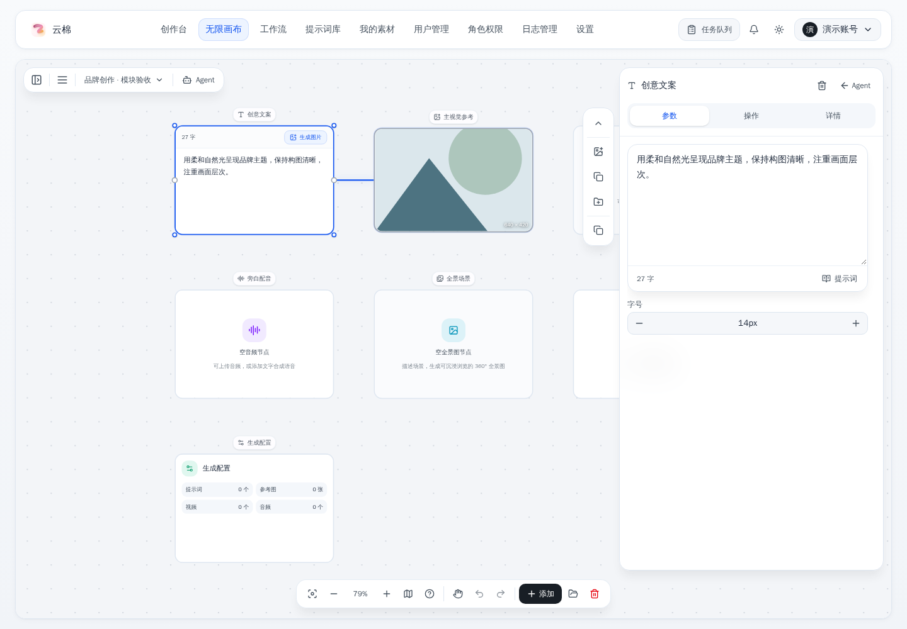
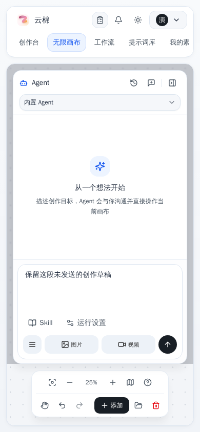

# 无限画布交互修复

## 修改内容

- 底部操作栏以完整工作区居中，侧栏展开、收起和调整宽度时不再移动或改变单双行布局。
- 左侧资源栏、Agent、节点面板和移动端遮罩预留底部操作区域；小地图保持在工具栏上方。
- Agent 打开时，点击节点可以查看参数、操作和详情。节点设置提供“返回 Agent”，保留会话、未发送草稿和节点引用。
- 快速点击节点标题后切换到 Agent，旧的延迟点击不再抢回节点面板；双击重命名逻辑保留。
- 短屏横向布局为工具栏保留空间，节点快捷操作区跟随面板可用高度。

## 验证

- 复用本项目 Vite 8002 和 Go 8090 源码服务；浏览器接口使用模拟数据，没有发起真实生成任务。
- 1440×1000、1024×768、768×900、390×844、320×740、844×390，共 64 条布局及交互检查通过。
- 文字、图片、视频、音频、全景图、导演台、生成配置，7 类节点的面板切换、可用标签页和草稿保留检查通过。
- 手机及短屏下，节点面板打开后的添加菜单和缩放菜单均可操作。
- `npm run lint`：通过，0 警告、0 错误。
- `npm test`：1003 项通过，0 项失败。
- `npm run build`：通过，保留既有构建分包体积提示。
- `go test ./...`：通过。
- `git diff --check`：本次涉及的已跟踪文件通过。

## 截图

